# Registro de Cambios de Diseño (CAMBIOS_DISENO.md)

Este documento registra todas las desviaciones, correcciones y refinamientos realizados sobre el diagrama de clases PlantUML original y el documento de análisis (`proyecto_análisis.txt`) durante la implementación incremental de **A La Mano**.

Prioridad aplicada ante contradicciones:
1. Historias de usuario (HU01–HU18) y criterios Gherkin.
2. Diagrama de clases PlantUML.
3. Resto del documento de diseño.

---

## Sprint 1 — HU01 a HU06 (Usuarios, Verificación, Login, Búsqueda y Perfil)

### 1. Resumen de desviaciones y justificaciones (Sprint 1)

| # | Cambio respecto al diagrama / documento | Justificación |
| :-: | :--- | :--- |
| 1 | **Cardinalidad `Cliente "1" *-- "0..*" MetodoPago`** (en lugar de `1` a `1`). | **HU13** permite registrar métodos de pago bajo demanda y **HU14** exige permitir reintentar el cobro con *otro* método de pago si el primero falla. |
| 2 | **Atributo `celular` movido de `Cliente` a `Usuario`.** | **HU02**, **HU04** y el validador único DRY exigen celular colombiano de 10 dígitos para cualquier cuenta registrada. |
| 3 | **Agregado `RECHAZADA` en `EstadoSolicitud` y `motivoRechazo` en `Solicitud` y `Profesional`.** | **HU07** define explícitamente el estado `"Rechazada"` con motivo opcional cuando el técnico declina una solicitud; **HU03** exige indicar y notificar un motivo al rechazar los documentos de un profesional. |
| 4 | **Tipos de datos en Java y SQL (`Long`, `BigDecimal`, `OffsetDateTime`, `ENUM`/`CHECK`, ASCII `contrasena`).** | Evita desbordamientos en PK, elimina errores de precisión binaria en montos financieros (`BigDecimal` / `NUMERIC(12,2)`), preserva zona horaria, reemplaza strings sueltos por enums + `CHECK` portables entre PostgreSQL y H2, y usa `contrasena` sin `ñ` por portabilidad. |
| 5 | **Atributos `latitud` y `longitud` (`Double`) en `Cliente` y `Profesional` + `idAdminVerificador` en `Profesional`.** | **HU05** requiere búsqueda por cercanía geográfica (fórmula Haversine) y **HU03** exige trazabilidad de verificación. |
| 6 | **Registro inicial de `Servicio` sin tarifas en HU02 y separación de tasa de garantía (\$3.000 COP).** | En **HU02** el profesional selecciona categorías antes de configurar tarifas (**HU08**). La garantía fija de \$3.000 COP se aplica aparte al pagar para cumplir **HU09** y **PU-01**. |
| 7 | **Desacoplamiento por puertos e infraestructura de seguridad (`IUsuarioRepositorio`, `RepositorioFactory`, `IAlmacenamientoArchivos`, `IConsultaReputacion`, `AuditoriaAdministrativa`, `Notificacion`, `TokenRevocado`).** | URLs firmadas temporales para documentos privados, auditoría inmutable mediante patrón Command, notificaciones internas y revocación real de JWT en `logout`. |
| 8 | **SQL portable sin extensiones ni `CREATE TYPE` propietarios.** | Permite ejecutar exactamente las mismas migraciones Flyway (`V1`–`V7`) en PostgreSQL real (Supabase / Docker) y en H2 (`MODE=PostgreSQL`). |
| 9 | **Herencia JPA `JOINED` para `Usuario` → `Cliente`, `Profesional`, `Administrador`.** | Evita columnas nulas cruzadas en una sola tabla. |

---

## Sprint 2 — HU07 a HU12 (Solicitudes, Tarifas, Strategy, State, Chat y Reseñas)

### 2. Resumen de desviaciones y justificaciones (Sprint 2)

| # | Cambio respecto al diagrama / documento | Justificación |
| :-: | :--- | :--- |
| 10 | **Patrón GoF State explícito (`IEstadoSolicitudState`, `FabricaEstadoSolicitud` y clases por estado) + `@Version` en `Solicitud`.** | Garantiza que las transiciones inválidas lancen excepción de forma determinista y evita condiciones de carrera (dos aceptaciones simultáneas: una gana y la otra recibe `409 Conflict`). |
| 11 | **Campo `precioFinalConfirmado` y `fechaFinalizacion` en `Solicitud`.** | **HU10** exige que el cliente confirme explícitamente el precio final registrado antes de pasar a `FINALIZADA` y habilitar el cobro; si lo rechaza, pasa a `EN_DISPUTA` sin habilitar cobro y notificando a soporte. |
| 12 | **Inmutabilidad explícita de `precioFinal` al registrarse.** | **HU10** establece que el registro del precio final debe quedar asociado de forma inmutable a la solicitud. |
| 13 | **Fotografías de solicitud (`solicitud_fotos`, máx. 3 JPG/PNG) almacenadas detrás de `IAlmacenamientoArchivos` con URLs firmadas.** | Respeta **HU07** (hasta 3 fotos del problema) y mantiene privacidad mediante enlaces temporales firmados en lugar de exponer rutas públicas. |
| 14 | **Tarificación Strategy (`ITarificacionStrategy`, `TarifaEstandarStrategy`, `TarifaUrgenciaStrategy`, `TarificadorContext`, `CalculadorTarifa`) y endpoint `GET /api/cotizaciones/estimar`.** | **HU09** exige cotización en tiempo real al activar el switch de urgencia antes de crear la solicitud; `Servicio.calcularPrecioEstimado` implementa el cálculo (Experto en Información) y `Solicitud` delega en él. |
| 15 | **Chat detrás de interfaz `IMensajeriaChat` con implementación `ServicioMensajeriaRest` y polling cada 2 s en la app móvil.** | Cumple **HU11** (`< 3 s` de latencia, historial persistente y estado `ENVIADO`/`LEIDO`) con total estabilidad en Expo Go y dejando lista la interfaz para migrar a WebSocket STOMP. |
| 16 | **Reputación real (`ConsultaReputacionJpaAdaptador`) reemplazando al adaptador temporal del Sprint 1 y añadiendo `cliente`/`profesional` en `Resena`.** | **HU12** exige recalcular `calificacionPromedio` al instante y **HU06** muestra promedio y últimos comentarios reales. Guardar referencias directas en `Resena` simplifica consultas indexadas sin afectar integridad. |
| 17 | **Restricción de envío único de reseña (`UNIQUE` en `resenas.id_solicitud`) y validación de rango `1..5` en Java y SQL.** | Impide duplicar reseñas incluso bajo concurrencia (**HU12**). |

---

## Sprint 3 — HU13 a HU18 + PayPal Sandbox (Métodos de pago, Custodia, Reportes, Moderación y Soporte)

### 3. Resumen de desviaciones y justificaciones (Sprint 3)

| # | Cambio respecto al diagrama / documento | Justificación |
| :-: | :--- | :--- |
| 18 | **Desglose explícito en `Pago` (`montoServicio`, `tasaGarantia`, `cantidad`), `referenciaIdempotencia`, `referenciaPasarela`, `motivoRechazo` y `@Version`.** | **HU14** exige cobrar `precioFinal + garantía ($3.000)` como línea separada, garantizar idempotencia ante doble clic y emitir `ComprobantePagoDTO` estructurado (`Pago.generarComprobante()`). Si un intento es `RECHAZADO` o `CANCELADO`, se libera el sufijo único para permitir reintentar sin afectar la solicitud `FINALIZADA`. |
| 19 | **Atributos adicionales en `MetodoPago` (`franquicia`, `titular`, `mesVencimiento` nullable, `anioVencimiento` nullable, `activo`) y tipo `PAYPAL`.** | **HU13** requiere validar vencimiento en tarjetas de prueba (en modo `simulada`), mientras que con **PayPal** el cliente no registra ni almacena tarjetas ni CVV (`TipoMetodoPago.PAYPAL`, sin fechas de vencimiento). En la app móvil, `MetodosPagoScreen` oculta el formulario de tarjeta cuando `pasarelaActiva = paypal`. |
| 20 | **`EstadoFinalizadaState.puedeLiberarCustodia()` ajustado a `false`; liberación permitida solo en estado `PAGADA` sin reportes abiertos.** | En el diagrama original `FINALIZADA` era el estado previo al desembolso; al separar `PAGADA` (fondos en estado `RETENIDO`), la liberación en custodia únicamente aplica cuando ya hubo cobro (`PAGADA`) y no existen disputas ni reportes pendientes (`Solicitud.puedeLiberarCustodia(boolean)`). |
| 21 | **Puertos entre `gestion_servicios`, `pagos` y `moderacion_reportes` (`IConsultaPagoSolicitud`, `IConsultaReportesAbiertos`, `IRegistradorDisputaSoporte`).** | Evita dependencias circulares entre módulos al consultar flags de pago/reportes en `SolicitudDTO` y al enlazar automáticamente un `CasoSoporte` cuando una solicitud pasa a `EN_DISPUTA`. |
| 22 | **Anonimato bidireccional mediante DTOs diferenciados (`ReporteVistaReportanteDTO`, `ReporteVistaReportadoDTO`, `ReporteAdminDTO`).** | **HU15/HU16** prohíben que el usuario reportado conozca quién lo reportó; `ReporteVistaReportadoDTO` excluye estructuralmente cualquier campo del reportante. |
| 23 | **Sanciones polimórficas con `ISancionable` (`SancionCliente`, `SancionProfesional`) + campos `suspendidoHasta` y `motivoSuspension` en `Usuario`.** | **HU17** exige suspender temporalmente (bloqueando login/operación hasta la fecha fin y ocultando al profesional en búsquedas) o desactivar cuentas de forma polimórfica sin condicionales `if (rol == ...)`, dejando la resolución inmutable (`@Version` + validación de estado `PENDIENTE`) registrada vía `IComandoAdministrativo`. |
| 24 | **Campos `asunto`, `numeroCaso`, `estadoCaso`, `respuestaAdmin` y `idAdminRespondedor` en `CasoSoporte` (`CasoSoporte.responder()`).** | **HU18** requiere confirmación inmediata con número de caso único (`SUP-YYYY-...`), respuesta administrativa y visibilidad directa para el usuario y en la bandeja admin (incluidas disputas de precio final). |
| 25 | **Sustitución de Wompi por PayPal Sandbox (`PayPalAdapter`) como pasarela real del MVP, manteniendo `WompiAdapter` como esqueleto y `PasarelaSimulada` para pruebas offline/`test`.** | **PayPal REST API v2** permite ejecutar pagos reales en Sandbox con esquema de dos pasos (`intent = AUTHORIZE` → `authorize` como `RETENIDO`, `capture` como `LIBERADO`, `void` o `refund` como `REEMBOLSADO`) sin SDK pesado, usando `RestClient` y caché OAuth2 por variables de entorno. |
| 26 | **Segregación de interfaz `IPasarelaPagoRedireccion extends IPasarelaPagos` y nuevos estados `PENDIENTE_APROBACION` / `CANCELADO` en `Pago`.** | Aplicando **Interface Segregation (ISP)**, las pasarelas directas (`PasarelaSimulada`, `WompiAdapter`) no se ven forzadas a implementar redirección ni deep linking, mientras `PayPalAdapter` aporta `iniciarPago` (`approvalUrl`) y `confirmarYAutorizarPago` (validando el estado `APPROVED` directamente en PayPal, nunca confiando en el frontend). `PayPalRetornoController` facilita el regreso a Expo Go (`expo-web-browser` + `expo-linking`). |
| 27 | **Conversión configurable COP → USD (`TarifaConfig.convertirCopAUsd`, `montoUsd`, `tasaCambioUsd`, `referenciaOrdenExterna`, `referenciaCaptura`, `autorizacionExpiraEn` en `Pago`).** | De acuerdo con la documentación oficial de PayPal REST APIs, el procesamiento/liquidación estándar en cuentas Sandbox no opera nativamente sobre saldos en COP (`CURRENCY_NOT_SUPPORTED`), por lo que el sistema convierte COP a `USD` usando `PAYPAL_TASA_CAMBIO_COP_USD` (defecto `4000.00`), persiste monto original COP, monto USD y tasa aplicada, y muestra ambos en el resumen y comprobante. Se registra como deuda técnica el manejo automático de autorizaciones PayPal expiradas (> 29 días). |

---

### 4. Diagrama de clases PlantUML completo y final (Cierre Sprint 3 + PayPal Sandbox)

```plantuml
@startuml
skinparam classAttributeIconSize 0

enum RolUsuario {
  CLIENTE
  PROFESIONAL
  ADMINISTRADOR
}

enum EstadoCuenta {
  ACTIVA
  SUSPENDIDA
  DESACTIVADA
}

enum EstadoVerificacion {
  PENDIENTE_VERIFICACION
  VERIFICADO
  RECHAZADO
}

enum EstadoSolicitud {
  PENDIENTE
  ACEPTADA
  RECHAZADA
  EN_CAMINO
  EN_PROGRESO
  FINALIZADA
  EN_DISPUTA
  CANCELADA
  PAGADA
}

enum EstadoMensaje {
  ENVIADO
  LEIDO
}

enum TipoMetodoPago {
  TARJETA_CREDITO
  TARJETA_DEBITO
  PAYPAL
}

enum FranquiciaTarjeta {
  VISA
  MASTERCARD
  AMEX
  PAYPAL
  OTRA
}

enum EstadoPago {
  PENDIENTE_APROBACION
  RETENIDO
  LIBERADO
  RECHAZADO
  REEMBOLSADO
  CANCELADO
}

enum MotivoReporte {
  NO_SE_PRESENTO
  MAL_COMPORTAMIENTO
  COBRO_INDEBIDO
  MALA_CALIDAD
  CANCELACION_INJUSTIFICADA
  MALTRATO
  NO_PAGO
  INFORMACION_FALSA
  + aplicaParaRolReportante(rol: RolUsuario): boolean
}

enum EstadoReporte {
  PENDIENTE
  RESUELTO
  DESCARTADO
}

enum AccionModeracion {
  ADVERTENCIA
  SUSPENSION_TEMPORAL
  DESACTIVACION
  DESCARTAR
}

enum DecisionPagoModeracion {
  SIN_CAMBIO
  REEMBOLSAR
  LIBERAR
}

enum EstadoCasoSoporte {
  ABIERTO
  RESPONDIDO
  CERRADO
}

interface IUsuarioRepositorio <<Interface>>
interface ISolicitudRepositorio <<Interface>>
interface IAlmacenamientoArchivos <<Interface>>
interface IComandoAdministrativo <<Interface>> {
  + ejecutar(): R
}
interface IConsultaReputacion <<Interface>> {
  + obtenerResumen(idProfesional: Long): ResumenReputacion
}
interface IConsultaReportesAbiertos <<Interface>> {
  + existeReporteAbierto(idSolicitud: Long): boolean
}
interface IConsultaPagoSolicitud <<Interface>> {
  + consultarPagoActual(idSolicitud: Long): Optional<ResumenPagoSolicitud>
}
interface IRegistradorDisputaSoporte <<Interface>> {
  + crearCasoPorDisputa(solicitud: Solicitud, motivo: String): String
}

interface ITarificacionStrategy <<Interface>> {
  + aplicaParaUrgencia(): boolean
  + calcular(tarifaBase: BigDecimal): BigDecimal
  + obtenerFactorAplicado(): BigDecimal
}
class TarifaEstandarStrategy
class TarifaUrgenciaStrategy
class TarificadorContext
class CalculadorTarifa
class TarifaConfig {
  + convertirCopAUsd(montoCop: BigDecimal): BigDecimal
}

interface IEstadoSolicitudState <<Interface>> {
  + getEstado(): EstadoSolicitud
  + aceptar(solicitud: Solicitud): void
  + rechazar(solicitud: Solicitud, motivo: String): void
  + registrarPrecioFinal(solicitud: Solicitud, precio: BigDecimal): void
  + confirmarPrecioFinal(solicitud: Solicitud): void
  + rechazarPrecioFinal(solicitud: Solicitud): void
  + marcarPagada(solicitud: Solicitud): void
  + chatHabilitado(): boolean
  + puedeResenarse(): boolean
  + puedeLiberarCustodia(): boolean
}
class FabricaEstadoSolicitud

interface IMensajeriaChat <<Interface>> {
  + enviarMensaje(idSolicitud: Long, idRemitente: Long, contenido: String): MensajeDTO
  + listarMensajes(idSolicitud: Long, idUsuario: Long): List<MensajeDTO>
  + marcarComoLeido(idSolicitud: Long, idMensaje: Long, idUsuario: Long): MensajeDTO
}
class ServicioMensajeriaRest

interface IPasarelaPagos <<Interface>> {
  + validarMetodo(datos: DatosTarjetaValidacion): ResultadoValidacionMetodo
  + procesarCobro(tokenMetodo: String, montoTotal: BigDecimal, referencia: String): ResultadoTransaccionPasarela
  + liberarFondos(referenciaPasarela: String, monto: BigDecimal): ResultadoTransaccionPasarela
  + reembolsarFondos(referenciaPasarela: String, monto: BigDecimal, motivo: String): ResultadoTransaccionPasarela
  + reembolsarCaptura(referenciaCaptura: String, monto: BigDecimal, motivo: String): ResultadoTransaccionPasarela
  + obtenerTipoPasarela(): String
  + requiereAprobacionExterna(): boolean
}
interface IPasarelaPagoRedireccion <<Interface>> {
  + iniciarPago(montoUsd: BigDecimal, moneda: String, ref: String, desc: String, returnUrl: String, cancelUrl: String): ResultadoInicioPago
  + confirmarYAutorizarPago(idOrdenExterna: String, ref: String): ResultadoAutorizacionPago
}
class PayPalAdapter <<Active MVP Sandbox>> {
  - tokenAccesoCache: String
  - expiracionTokenCache: Instant
  + iniciarPago(...): ResultadoInicioPago
  + confirmarYAutorizarPago(...): ResultadoAutorizacionPago
  + liberarFondos(...): ResultadoTransaccionPasarela
  + reembolsarFondos(...): ResultadoTransaccionPasarela
  + reembolsarCaptura(...): ResultadoTransaccionPasarela
}
class PasarelaSimulada <<Test / Offline>>
class WompiAdapter <<Esqueleto>>

interface ISancionable <<Interface>> {
  + getRolSoportado(): RolUsuario
  + aplicarAdvertencia(usuario: Usuario, justificacion: String): String
  + aplicarSuspensionTemporal(usuario: Usuario, hasta: OffsetDateTime, justificacion: String): String
  + aplicarDesactivacion(usuario: Usuario, justificacion: String): String
}
class SancionCliente
class SancionProfesional

class RepositorioFactory
class ServicioAutenticacion
class ServicioVerificacion
class ServicioBusquedaProfesionales
class GestorSolicitudes
class ServicioResenas
class ConsultaReputacionJpaAdaptador
class ServicioMetodosPago
class ServicioPagos
class PayPalRetornoController
class ServicioReportes
class ServicioModeracion
class ServicioSoporte
class ServicioAuditoria
class ServicioNotificaciones

abstract class CreadorUsuario {
  + registrar(datos: DatosRegistroUsuario): Usuario
  # {abstract} crearUsuario(datos: DatosRegistroUsuario, hash: String): Usuario
}
class CreadorCliente
class CreadorProfesional

abstract class Usuario {
  - idUsuario: Long
  - nombre: String
  - correo: String
  - celular: String
  - contrasena: String
  - rol: RolUsuario
  - fechaRegistro: OffsetDateTime
  - estadoCuenta: EstadoCuenta
  - intentosFallidos: int
  - bloqueadoHasta: OffsetDateTime [0..1]
  - suspendidoHasta: OffsetDateTime [0..1]
  - motivoSuspension: String [0..1]
  - fotoPerfil: String [0..1]
  + suspenderTemporalmente(hasta: OffsetDateTime, motivo: String): void
  + desactivarCuenta(motivo: String): void
  + levantarSuspensionSiExpiro(ahora: OffsetDateTime): boolean
  + estaSuspendidaVigente(ahora: OffsetDateTime): boolean
  + estaActiva(): boolean
}

class Cliente {
  - ubicacion: String
  - latitud: Double
  - longitud: Double
}

class Administrador

class Profesional {
  - ubicacion: String
  - latitud: Double
  - longitud: Double
  - documentoIdentidad: String
  - documentosCertificacion: List<String>
  - estadoVerificacion: EstadoVerificacion
  - motivoRechazo: String [0..1]
  - fechaVerificacion: OffsetDateTime [0..1]
  - idAdminVerificador: Long [0..1]
  - disponible: boolean
  + verificar(admin: Administrador): void
  + rechazarVerificacion(admin: Administrador, motivo: String): void
  + establecerDisponibilidad(disponible: boolean): void
  + suspenderTemporalmente(hasta: OffsetDateTime, motivo: String): void
  + desactivarCuenta(motivo: String): void
  + esVisibleEnBusqueda(): boolean
}

class CategoriaOficio {
  - idCategoria: Long
  - nombre: String
  - descripcion: String
}

class Servicio {
  - idServicio: Long
  - tarifaBase: BigDecimal [0..1]
  - precioMin: BigDecimal [0..1]
  - precioMax: BigDecimal [0..1]
  + configurarTarifa(base: BigDecimal, min: BigDecimal, max: BigDecimal): void
  + ajustarALimites(precio: BigDecimal): BigDecimal
  + calcularPrecioEstimado(esUrgente: boolean, ctx: TarificadorContext): ResultadoCotizacion
}

class Solicitud {
  - idSolicitud: Long
  - descripcion: String
  - fotos: List<String> [0..3]
  - estadoSolicitud: EstadoSolicitud
  - motivoRechazo: String [0..1]
  - esUrgente: boolean
  - precioEstimado: BigDecimal
  - precioFinal: BigDecimal [0..1]
  - precioFinalConfirmado: boolean
  - fechaSolicitud: OffsetDateTime
  - fechaFinalizacion: OffsetDateTime [0..1]
  - version: Long
  + calcularPrecioEstimado(ctx: TarificadorContext): BigDecimal
  + aceptar(): void
  + rechazar(motivo: String): void
  + registrarPrecioFinal(precio: BigDecimal): void
  + confirmarPrecioFinal(): void
  + rechazarPrecioFinal(): void
  + marcarPagada(): void
  + resenar(estrellas: int, comentario: String): Resena
  + chatHabilitado(): boolean
  + puedeResenarse(): boolean
  + puedeLiberarCustodia(): boolean
  + puedeLiberarCustodia(existenReportesAbiertos: boolean): boolean
}

class Chat
class Mensaje
class Resena

class MetodoPago {
  - idMetodoPago: Long
  - token: String
  - tipo: TipoMetodoPago
  - franquicia: FranquiciaTarjeta
  - ultimosDigitos: String
  - titular: String
  - mesVencimiento: Integer [0..1]
  - anioVencimiento: Integer [0..1]
  - activo: boolean
  - fechaRegistro: OffsetDateTime
  + {static} crearMetodoPayPal(cliente: Cliente, correoOAlias: String): MetodoPago
  + desactivar(): void
  + estaVencido(actual: YearMonth): boolean
  + resumenEnmascarado(): String
}

class Pago {
  - idPago: Long
  - pasarela: String
  - montoServicio: BigDecimal
  - tasaGarantia: BigDecimal
  - cantidad: BigDecimal
  - montoUsd: BigDecimal [0..1]
  - tasaCambioUsd: BigDecimal [0..1]
  - referenciaIdempotencia: String
  - referenciaPasarela: String [0..1]
  - referenciaOrdenExterna: String [0..1]
  - urlAprobacion: String [0..1]
  - referenciaCaptura: String [0..1]
  - autorizacionExpiraEn: OffsetDateTime [0..1]
  - estadoPago: EstadoPago
  - motivoRechazo: String [0..1]
  - fechaPago: OffsetDateTime
  - fechaActualizacion: OffsetDateTime
  - version: Long
  + ejecutarCobro(pasarela: IPasarelaPagos): void
  + iniciarAprobacionExterna(pasarela: IPasarelaPagoRedireccion, desc: String, ret: String, canc: String): void
  + confirmarAutorizacionExterna(pasarela: IPasarelaPagoRedireccion): void
  + marcarCancelado(motivo: String): void
  + liberarCustodia(pasarela: IPasarelaPagos): void
  + reembolsar(pasarela: IPasarelaPagos, motivo: String): void
  + generarComprobante(): ComprobantePagoDTO
}

class Reporte {
  - idReporte: Long
  - motivo: MotivoReporte
  - descripcion: String
  - esPrioritario: boolean
  - estadoReporte: EstadoReporte
  - accionTomada: AccionModeracion [0..1]
  - justificacionResolucion: String [0..1]
  - diasSuspension: Integer [0..1]
  - decisionPago: DecisionPagoModeracion [0..1]
  - idAdminResolutor: Long [0..1]
  - fechaReporte: OffsetDateTime
  - fechaResolucion: OffsetDateTime [0..1]
  - version: Long
  + resolver(admin: Administrador, accion: AccionModeracion, justificacion: String, dias: Integer, decisionPago: DecisionPagoModeracion): void
  + estaAbierto(): boolean
}

class CasoSoporte {
  - idCaso: Long
  - numeroCaso: String
  - asunto: String
  - descripcion: String
  - estadoCaso: EstadoCasoSoporte
  - respuestaAdmin: String [0..1]
  - idAdminRespondedor: Long [0..1]
  - fechaCreacion: OffsetDateTime
  - fechaRespuesta: OffsetDateTime [0..1]
  + responder(admin: Administrador, respuesta: String, cerrar: boolean): void
}

class AuditoriaAdministrativa
class Notificacion
class TokenRevocado

CreadorUsuario <|-- CreadorCliente
CreadorUsuario <|-- CreadorProfesional
Usuario <|-- Cliente
Usuario <|-- Administrador
Usuario <|-- Profesional

ITarificacionStrategy <|.. TarifaEstandarStrategy
ITarificacionStrategy <|.. TarifaUrgenciaStrategy
TarificadorContext o-- ITarificacionStrategy
CalculadorTarifa --> TarificadorContext
CalculadorTarifa --> TarifaConfig

Solicitud ..> FabricaEstadoSolicitud
FabricaEstadoSolicitud --> IEstadoSolicitudState
IMensajeriaChat <|.. ServicioMensajeriaRest
IConsultaReputacion <|.. ConsultaReputacionJpaAdaptador

IPasarelaPagos <|-- IPasarelaPagoRedireccion
IPasarelaPagoRedireccion <|.. PayPalAdapter
IPasarelaPagos <|.. PasarelaSimulada
IPasarelaPagos <|.. WompiAdapter
ISancionable <|.. SancionCliente
ISancionable <|.. SancionProfesional

RepositorioFactory --> IUsuarioRepositorio
RepositorioFactory --> ISolicitudRepositorio
GestorSolicitudes --> ISolicitudRepositorio
GestorSolicitudes --> IAlmacenamientoArchivos
GestorSolicitudes --> IConsultaPagoSolicitud
GestorSolicitudes --> IConsultaReportesAbiertos
GestorSolicitudes --> IRegistradorDisputaSoporte

ServicioMetodosPago --> IPasarelaPagos
ServicioMetodosPago --> TarifaConfig
ServicioPagos --> IPasarelaPagos
ServicioPagos --> TarifaConfig
ServicioPagos --> IConsultaReportesAbiertos
ServicioPagos --> ServicioAuditoria
ServicioModeracion --> ISancionable
ServicioModeracion --> ServicioPagos
ServicioModeracion --> ServicioAuditoria
ServicioModeracion ..> IComandoAdministrativo
ServicioVerificacion ..> IComandoAdministrativo
ServicioSoporte ..|> IRegistradorDisputaSoporte
ServicioSoporte ..> IComandoAdministrativo
ServicioResenas --> IConsultaReputacion

Cliente "1" *-- "0..*" MetodoPago
Cliente "1" *-- "0..*" Solicitud : Solicita
Profesional "1" *-- "1..*" Servicio
Solicitud "1" *-- "0..*" Pago
Solicitud "1" *-- "0..*" Reporte
Solicitud "1" *-- "0..1" Resena
Solicitud "1" *-- "0..1" Chat
Solicitud "0..1" -- "0..*" CasoSoporte : Relacionado
Chat "1" *-- "0..*" Mensaje

Profesional "1" -- "0..*" Solicitud : Recibe
Solicitud "0..*" -- "1" Servicio
Servicio "0..*" -- "1" CategoriaOficio
Resena "0..*" -- "1" Profesional
Pago "0..*" -- "1" MetodoPago
Pago ..> IPasarelaPagos
Usuario "1" -- "0..*" Mensaje : Remite
Usuario "1" -- "0..*" Reporte : Reporta / Recibe
Usuario "1" -- "0..*" CasoSoporte : Abre
Administrador "0..1" -- "0..*" Profesional : Verifica
Administrador "1" -- "0..*" AuditoriaAdministrativa : Registra
Usuario "1" -- "0..*" Notificacion : Recibe
@enduml
```

